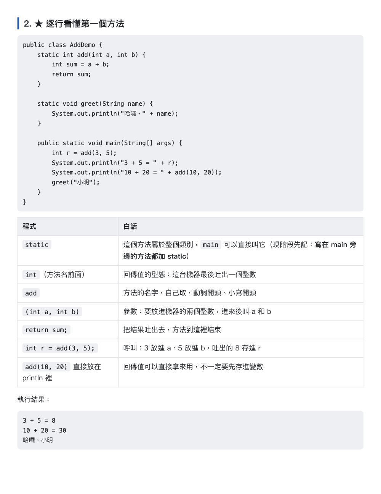
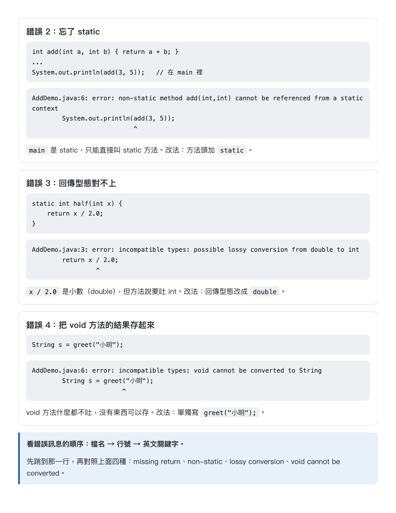
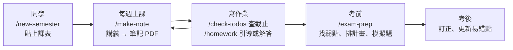

<div align="center">

# study-with-claude

**給台灣大學生的 Claude Code 學習工作區**

把每門課的資訊、截止日、講義、筆記、作業都放進同一個資料夾，<br>
讓 [Claude Code](https://claude.com/claude-code) 讀得懂你的整個學期，當你的課業家教。

[](LICENSE)


[快速開始](#快速開始) · [看示範](examples/115-1/) · [常見問題](#常見問題) · [一起改進](CONTRIBUTING.md)

</div>

---

## 為什麼要做這個

直接開 ChatGPT 或 Claude 問作業，有三個問題：

1. **每次都要從頭講**：哪門課、老師是誰、教到哪、作業截止是下午 5 點還是晚上 12 點，每次開新對話都要重講一次。
2. **東西散落各處**：老師的講義在下載資料夾，筆記在聊天紀錄，截止日在學校平台，考前找不到。
3. **一不小心就變成代寫**：答案拿到了，考試還是不會。

這個範本的做法是：**一學期一個資料夾、一門課一個資料夾，每門課都有一份 README 記下所有脈絡**。Claude Code 打開這個資料夾就知道你修什麼課、什麼時候要交什麼、你哪裡比較弱，回答時就不用你再交代一次。

這套做法來自作者自己一學期的實際使用（7 門課，包含程式、經濟、網路、作業系統、創業實務），再整理成任何學校都能用的通用版本。

## 成品長這樣

講義整理成**手機好讀的 PDF 筆記**：白話比喻、程式逐行解說、真實錯誤訊息、附答案的練習題。所有程式都實際執行過。

<table>
<tr>
<td width="50%"></td>
<td width="50%"></td>
</tr>
<tr>
<td align="center">逐行解說：左邊程式、右邊白話</td>
<td align="center">常見錯誤：附 javac 真實錯誤訊息與改法</td>
</tr>
</table>

完整 PDF：[examples/115-1/程式設計一/筆記/W03-方法.pdf](examples/115-1/程式設計一/筆記/W03-方法.pdf)

## 它能做什麼

| 你說 | Claude 會 |
|---|---|
| 「這是我的課表」（附截圖） | 建好每門課的資料夾和 README，記下老師、時間地點、評分方式、**AI 使用規定** |
| 「有沒有沒交的作業？」 | 從學校教學平台查待辦，更新截止日表，依截止時間排順序，特別標出「不是 23:59 截止」的 |
| 「陪我寫 HW3」 | 先問你怎麼想，卡住才一階一階給提示，最後實際執行你的程式來檢查 |
| 「幫我把 HW3 做完」 | 完整做完、照課程檔名規則存好，附思路、逐步講解、常見錯誤 |
| 「把這週講義整理成筆記」 | 產生上面那種 PDF，存進課程的 `筆記/` 資料夾 |
| 「下週期中考，幫我排複習」 | 讀你寫作業時卡住的紀錄找出弱點，排每日計畫，一題一題出題考你 |

不用記指令，用中文直接說就好。

## 一學期怎麼用



- **開學第一週**：把選課系統的課表截圖丟給 Claude，它會建好資料夾。接著把每門課的課程簡介投影片放進 `講義/`，Claude 會讀出評分方式和考試日期。
- **每週**：上完課把講義放進 `講義/`，說「整理這週的筆記」，手機上就有 PDF 可以複習。
- **作業**：問「這週要交什麼」，再選要「陪我寫」還是「幫我做完」。
- **考前**：說「幾號要考期中」，Claude 會從你的作業紀錄和自評找出弱點，排複習計畫。

## 作業的兩種模式

你決定每份作業要怎麼做，Claude 從你的說法判斷；說得不清楚時它會先問。

<table>
<tr><th width="50%">引導模式：「陪我寫」</th><th width="50%">解答模式：「幫我做完」</th></tr>
<tr>
<td valign="top">

> **你**：陪我寫 HW02 溫度換算
>
> **Claude**：先說說看，`fToC` 這個方法收到什麼？要回傳什麼？
>
> **你**：收到華氏，回傳攝氏，我寫好了但結果全是 0
>
> **Claude**：看第 10 行的 `(5 / 9)`。兩個整數相除，Java 會怎麼處理小數？你猜改成 `5.0 / 9` 會變怎樣？

適合想把觀念練熟、之後要上機考的時候。卡住的地方會記在「引導紀錄」，考前拿來複習。

</td>
<td valign="top">

> **你**：幫我把 HW02 做完
>
> **Claude**：好，完成了 `作業/hw02-溫度換算/`：
> - `HW02_學號_01.java`（已編譯執行，輸出附在檔案最後）
> - `說明.md`：這題在考方法的回傳型態；為什麼 `5 / 9` 會變 0；一題類似的練習

適合趕時間，或是作業已經交了、想看正解訂正的時候。這份會被記成「考前要自己再寫一次」。

</td>
</tr>
</table>

老師規定作業不能用 AI 代寫的課，Claude 給解答前會**提醒你一次**老師的原話，決定權在你。

## 快速開始

### 需要準備

- **Claude Code**：[桌面版或終端機版](https://claude.com/claude-code)都可以，需要能使用 Claude Code 的 Claude 帳號
- **Google Chrome 或 Microsoft Edge**：轉 PDF 用（Windows 內建的 Edge 就可以）
- （選用）**Claude in Chrome 擴充功能**：讓 Claude 讀你已登入的學校教學平台

### 步驟

1. 按這個頁面右上角的 **Use this template → Create a new repository**，**一定要選 Private**（裡面會放你的作業）。
   不用 GitHub 的話：**Code → Download ZIP**，解壓縮到你想放的地方。
2. 用 Claude Code 打開這個資料夾。
3. 輸入 `/setup`，回答幾個問題：學校、科系、程式基礎、作業系統、學校用哪個教學平台。
4. 輸入 `/new-semester`，貼上你的課表截圖。

完成。之後直接用中文跟 Claude 說你要做什麼就好。

## 資料夾結構

```
你的工作區/
├── CLAUDE.md                    Claude 的工作規則（通用，可以照自己習慣改）
├── CLAUDE.local.md              你的個人設定：學號、程式基礎、偏好（不會上傳）
├── 115-1/                       一學期一個資料夾（民國學年-學期）
│   ├── README.md                課表、課程表、截止日表、考試表
│   └── 程式設計一/
│       ├── README.md            老師、評分、AI 規定、繳交規則、進度、易錯點
│       ├── 講義/                老師的投影片（不會上傳）
│       ├── 作業/hw02-溫度換算/  題目、你的程式、引導紀錄
│       └── 筆記/
│           ├── W03-方法.pdf     ← 手機上看這個
│           └── 原始檔/          PDF 的 HTML 母本，之後要改從這裡改
├── _templates/                  筆記範本、README 範本
├── tools/                       轉 PDF 腳本（macOS／Linux 用 .sh，Windows 用 .ps1）
├── adapters/                    各校教學平台的操作說明
└── .claude/skills/              六個指令的詳細流程
```

想看填滿內容的樣子：[examples/115-1/](examples/115-1/)（虛構課程「程式設計一」）。

## 指令

| 指令 | 用途 |
|---|---|
| `/setup` | 第一次設定：個人資料、偏好、檢查轉 PDF 環境 |
| `/new-semester` | 從課表建立新學期；學期中加一門課也用這個 |
| `/check-todos` | 查未交作業與近期截止日，更新截止日表 |
| `/homework` | 寫作業：引導模式或解答模式 |
| `/make-note` | 講義、投影片、錄音逐字稿 → 筆記 PDF |
| `/exam-prep` | 考試資訊整理、弱點分析、每日複習計畫、模擬題 |

## 學校教學平台

Claude 透過你**自己已經登入**的瀏覽器分頁讀取課程資料，不碰你的帳號密碼。

| 平台 | 狀態 | 說明 |
|---|---|---|
| TronClass | ✅ 實測過 | 例：淡江大學 iClass |
| Canvas | 🧪 待實測 | 例：臺大 NTU COOL |
| Moodle | 🧪 待實測 | 多所學校使用 |
| 其他 | ✅ 可用 | 截圖或複製貼上待辦頁面即可 |

不知道你們學校用哪個？登入後看網址或頁尾的系統名稱。你們學校試過了嗎？[歡迎回報](CONTRIBUTING.md)。

## 原則

1. **你決定怎麼用**：引導或解答，依你每次的說法切換。
2. **知道每門課的 AI 規定**：每門課的 README 都記著老師的 AI 規定與出處，給解答前會提醒你。
3. **你按送出**：繳交作業、在討論區發文、寄信給老師，都由你看過、你決定。
4. **不碰密碼**：學校帳號一律你自己登入。
5. **隱私優先**：學號、姓名只存在本機的 `CLAUDE.local.md`；老師的講義和課程影片預設不上傳 GitHub。

## 常見問題

<details>
<summary><b>要錢嗎？</b></summary>

這個範本免費（MIT 授權）。Claude Code 本身需要 Claude 帳號，方案與費用以 [Claude 官網](https://claude.com/pricing)為準。

</details>

<details>
<summary><b>用解答模式交作業會不會有問題？</b></summary>

看老師的規定。有的老師允許把 AI 當學習夥伴，有的完全禁止。開學時請 Claude 把每門課的 AI 規定記進 README，給解答前它會提醒你。就算用了解答模式，也建議把說明讀懂：上機考、口頭詢問都不會有 AI 在旁邊。

</details>

<details>
<summary><b>我完全不會寫程式，也能用嗎？</b></summary>

可以。`/setup` 時程式基礎選「完全沒寫過」，筆記就會用最詳細的「零基礎」深度：每個觀念從比喻開始，每行程式都有白話解釋。非程式的課（經濟、會計、通識）一樣能用，筆記會改成觀念卡、例題和檢核題。

</details>

<details>
<summary><b>我的資料會不會被上傳？</b></summary>

`.gitignore` 預設排除了 `CLAUDE.local.md`（個人設定）、所有課程的 `講義/`、`影片/`。建立 repo 時請選 Private。和 Claude 對話的內容依 Anthropic 的隱私政策處理。

</details>

<details>
<summary><b>Windows 能用嗎？</b></summary>

可以。轉 PDF 用 `tools/note2pdf.ps1`，用的是 Windows 內建的 Edge。Windows 版腳本目前還在收集實測回報，遇到問題請[開 Issue](../../issues)。

</details>

<details>
<summary><b>可以用手機看筆記嗎？</b></summary>

這就是筆記做成 PDF 的原因：下載到手機就能離線看，通勤、排隊時複習。範本的排版是照手機閱讀設計的。

</details>

<details>
<summary><b>我們學校的教學平台不在清單上？</b></summary>

先用手動模式：把待辦頁截圖或複製貼上給 Claude 就能用。想自動化的話，照 [adapters/_範本.md](adapters/_範本.md) 寫一份，開 Pull Request 分享給同校同學。

</details>

## 接下來

- [ ] Windows 實測回報
- [ ] Canvas、Moodle adapter 在台灣學校實測
- [ ] 非程式課的示範（經濟學、會計）
- [ ] 報告類作業的流程（分組分工、簡報）

## 一起改進

最需要：**你們學校的教學平台 adapter**、**Windows 實測**、**其他科目的示範筆記**。見 [CONTRIBUTING.md](CONTRIBUTING.md)。

## 授權

[MIT](LICENSE) © [KCjasper](https://github.com/KCjasper)
